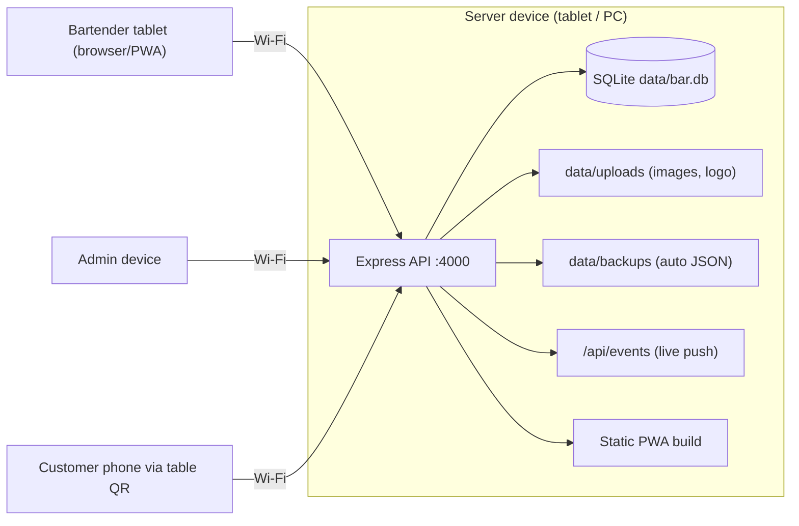
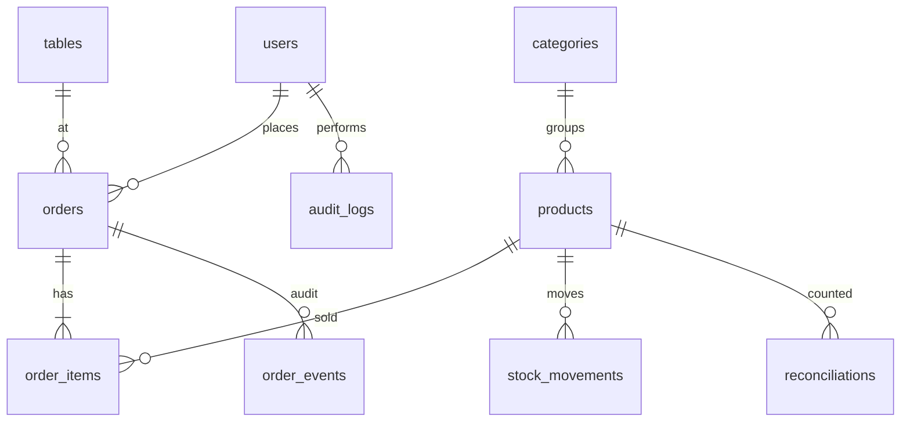

# DivinaBar – Architecture, Schema & Roadmap

## 1. Overview

* **One authoritative database** – only the server process opens SQLite. Every device (including the
  server tablet itself in standalone mode via `http://localhost:4000`) talks to the same API.
* **Standalone mode** = server + browser on the same tablet. **Local network mode** = same server; other
  devices open `http://<server-ip>:4000`. No code difference.
* **Offline** – no external calls anywhere. Service worker caches the app shell + images; IndexedDB caches
  menu/catalogue reads and queues orders created while the server is unreachable. Each order carries a
  `client_uuid`; the server enforces `UNIQUE(client_uuid)` so replays never duplicate.
* **Stock consistency** – deduction happens inside a SQLite transaction when an order becomes *Served*,
  guarded by `orders.stock_deducted` flag (idempotent). Cancelling a served order writes a reversal.

## 2. Modules

| Server (`server/src`) | Purpose |
|---|---|
| `db.js` | connection, migrations (versioned), transaction helper |
| `seed.js` | sample data (users, categories, products with local SVG images, tables, orders) |
| `auth.js` | scrypt PIN hashing, HMAC-signed tokens, `requireAuth`, `requireRole` |
| `routes/auth.js` | login, me, change PIN |
| `routes/users.js` | user CRUD, PIN reset, Excel import |
| `routes/catalog.js` | categories & products CRUD, image upload, favourites, public menu |
| `routes/orders.js` | create (dedup), lifecycle transitions, approval/dispute, audit trail |
| `routes/inventory.js` | purchases, wastage, complimentary, adjustments, reconciliation, history |
| `routes/tables.js` | tables + QR (PNG/SVG) generation |
| `routes/dashboard.js` | analytics aggregates |
| `routes/reports.js` | report datasets + XLSX/PDF export |
| `routes/admin.js` | settings, logo/background, backup/restore, audit log, notifications |
| `jobs.js` | approval expiry, automatic backups |
| `events.js` | Server-Sent-Events hub |

| Client (`client/src`) | Purpose |
|---|---|
| `lib/api.ts` | fetch wrapper, token, IndexedDB cache + offline order queue |
| `lib/auth.tsx` | auth context & role guard |
| `pages/POS.tsx` | product grid / cart (bartender, member, customer, QR) |
| `pages/OrdersBoard.tsx` | bartender kanban with live updates |
| `pages/MyOrders.tsx` | history + approve / dispute |
| `pages/Dashboard.tsx` | charts & KPIs |
| `pages/Inventory.tsx`, `Products.tsx`, `Users.tsx`, `Tables.tsx`, `Reports.tsx`, `Settings.tsx` | admin |
| `pages/QRMenu.tsx` | public table menu `/menu/:code` |

## 3. Database schema

* `users(id, name, service_no UNIQUE, rank, mobile, email, category POSTED|TD, role admin|member|bartender|customer, pin_hash, must_change_pin, active)`
* `categories(id, name UNIQUE, low_threshold, critical_threshold, sort)`
* `products(id, name, category_id, brand, description, image, size_ml, unit, is_peg, purchase_price, selling_price, peg_price, stock, min_stock, critical_stock, favourite, active)`
  – `stock` is held in **base units**: ml for peg-enabled spirits, units otherwise. Thresholds are in bottles/units.
* `tables(id, name, code UNIQUE, active)`
* `orders(id, order_no, client_uuid UNIQUE, user_id, created_by, table_id, type ondemand|prebooked, scheduled_at, status, notes, total, stock_deducted, approval_status, approval_at, dispute_note, closed_at, created_at, updated_at)`
  – status: `draft, placed, accepted, preparing, served, closed, cancelled, disputed`
  – approval_status: `na, pending, approved, disputed, expired`
* `order_items(id, order_id, product_id, name, serve_type bottle|peg|unit, peg_ml, qty, unit_price, line_total, base_qty)`
* `order_events(id, order_id, from_status, to_status, user_id, note, at)`
* `stock_movements(id, product_id, type purchase|sale|sale_reversal|wastage|complimentary|adjustment|removal|reconcile, qty (signed base units), unit_cost, supplier, invoice, order_id, note, user_id, at)`
* `reconciliations(id, product_id, system_qty, physical_qty, diff, note, user_id, at)`
* `settings(key PK, value)` · `audit_logs(...)` · `notifications(...)` · `schema_migrations(version)`

Opening stock for a period = current stock − Σ movements since period start; closing = opening + Σ movements in period.

## 4. Roadmap (implemented in order)
1. DB + migrations + seed → 2. Auth/RBAC → 3. Catalogue & inventory → 4. Orders + lifecycle + deduction →
5. Approval workflow + jobs → 6. Tables/QR + public menu → 7. Dashboard → 8. Reports XLSX/PDF →
9. Settings, theme, backup/restore, audit → 10. PWA/offline queue → 11. Workflow tests (`server/test/e2e.mjs`).
